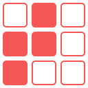

  

# Filtreur.js

Declarative user interface library for filtering elements on a web page.

Visit [**achrafkassioui.com/filtreur**](https://www.achrafkassioui.com/filtreur/).

## Change Log

### 0.92 beta – 13 Nov 2026

- Keyboard shortcuts ignore Cmd, Ctrl, Alt and Shift, held keys, and typing in fields.

### 0.9 beta – 14 May 2019

- First public version.

## License

Filtreur.js is published under the [GNU General Public License](https://www.gnu.org/licenses/gpl-3.0.en.html).
